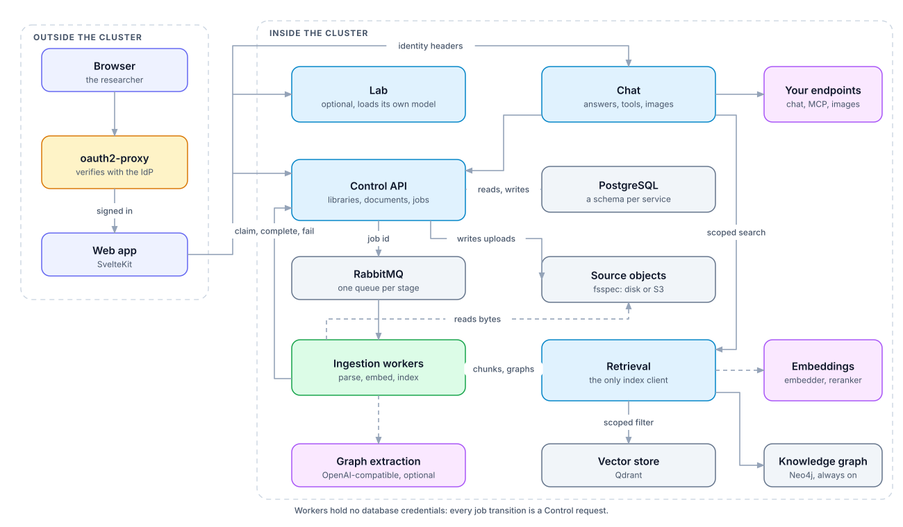
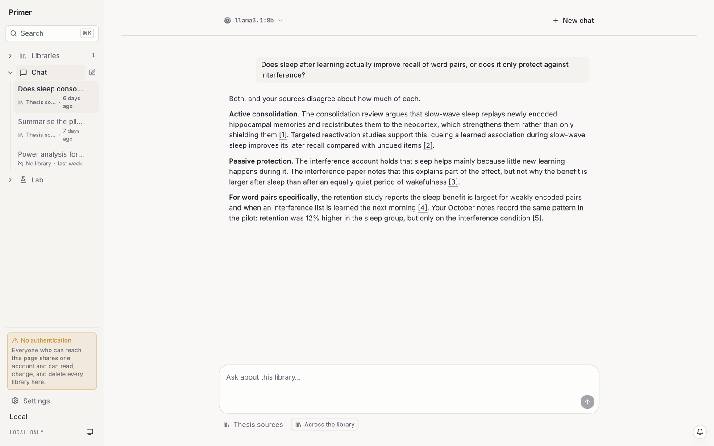
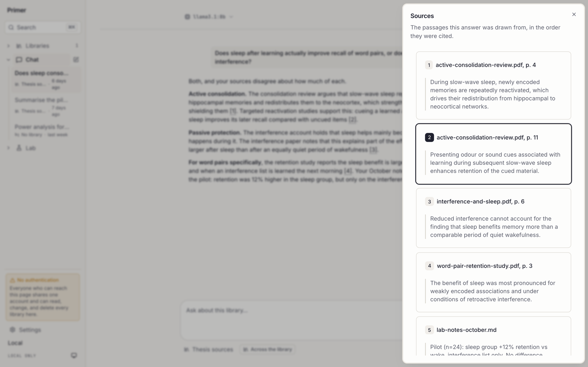
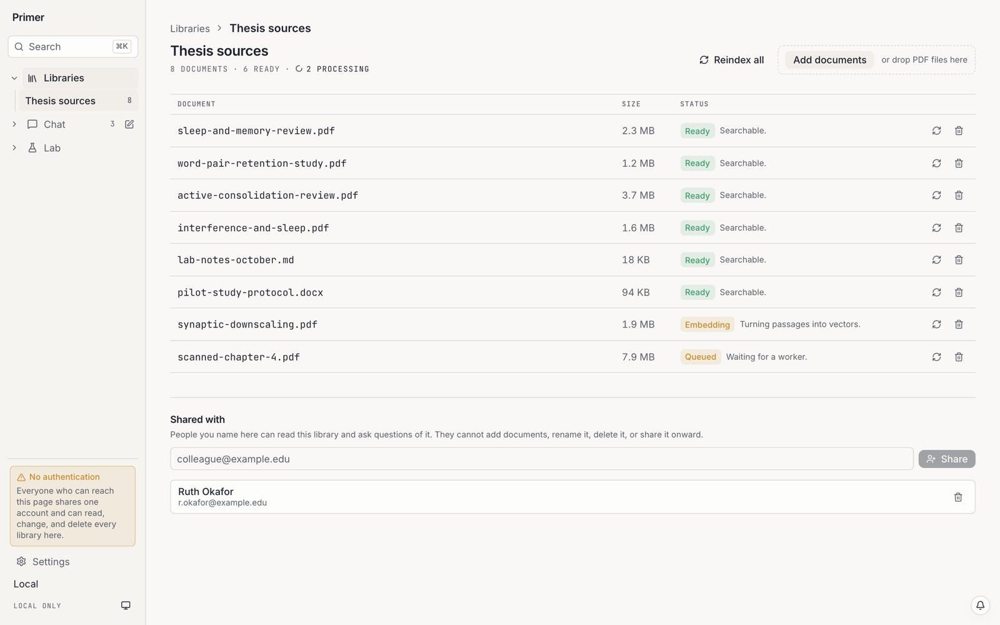
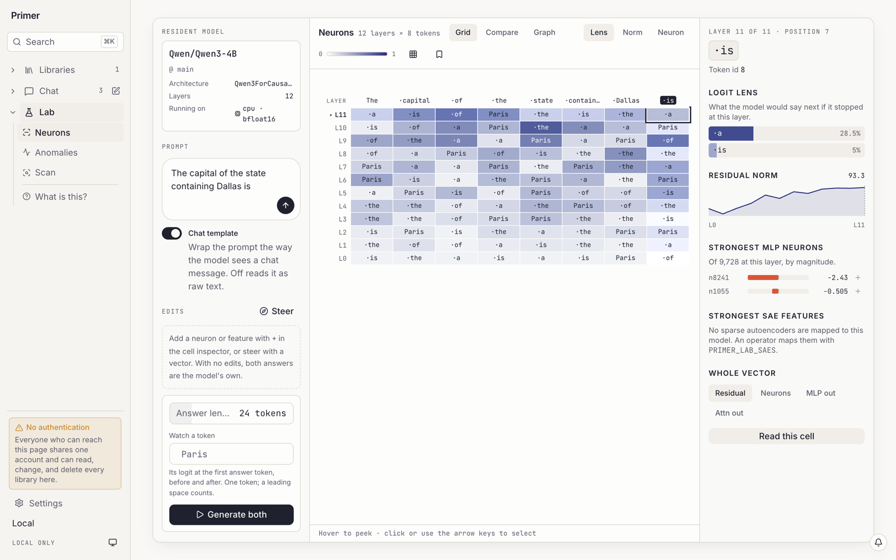
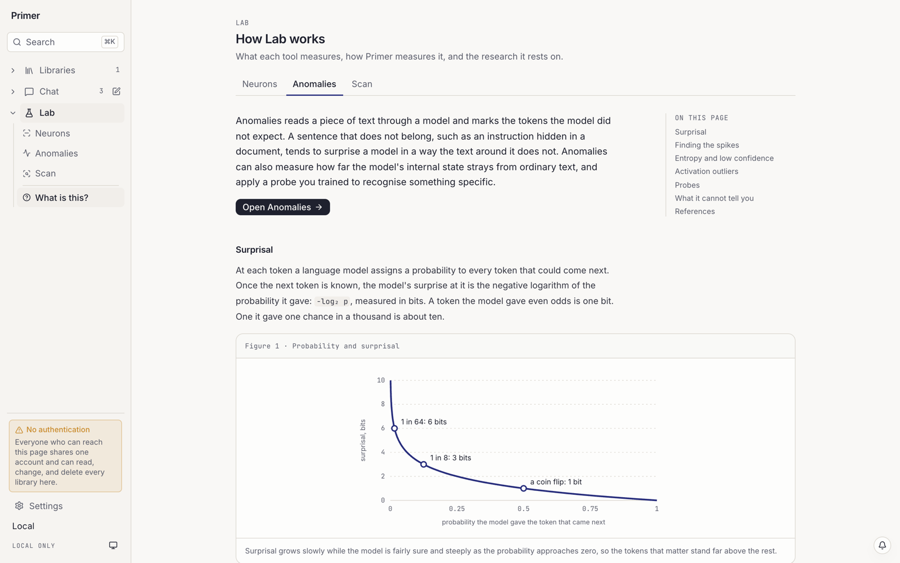

<div align="center">

# Primer

[](https://github.com/Harville-Labs/Primer/actions/workflows/ci.yml)
[](https://github.com/Harville-Labs/Primer/releases)
[](https://harville-labs.github.io/Primer/)
[](https://github.com/Harville-Labs/Primer/pkgs/container/charts%2Fprimer)

</div>

---

Primer is a self-hosted, multi-user assistant for your own documents. You put
sources into private libraries; it answers from those libraries alone, and
every claim points back at the passage it came from.

It exists for people who cannot or will not send their documents to a hosted
service. Everything runs on your infrastructure, against your own model
endpoints. **Primer calls no vendor.** It runs its own embedding model and
reranker, and answers with whichever chat model you point it at.

<div align="center">

<picture>
  <source media="(prefers-color-scheme: dark)" srcset="docs/assets/diagrams/architecture-dark.svg">
  
</picture>

</div>

## What it does

|  | |
|---|---|
| **Private by default** | A library belongs to one person. Nobody else can read it, list it, or discover that it exists. |
| **Real documents** | `.pdf` `.docx` `.pptx` `.md` `.markdown` `.txt` — including text that exists only inside images. |
| **Answers you can check** | Every citation names a passage in a specific *version* of a specific document, and is recorded with the answer rather than recomputed later. |
| **Connections across documents** | Optionally, a knowledge graph of the people, methods, and things your sources name. A question finds passages linked to what it mentions, not only passages that resemble it. |
| **Your models** | Any OpenAI-compatible endpoint — vLLM, Ollama, llama.cpp, or a hosted API. |
| **Chat on its own** | Use it as a plain chat interface, and link a library when you want the answer grounded and cited. |
| **Tools, only with consent** | MCP tools run in the operator's own servers, and only after a person approves that specific call. Primer never touches the host shell. |

## What it looks like

An answer cites the passages it came from, and each marker opens the passage
it names.

<picture>
  <source media="(prefers-color-scheme: dark)" srcset="docs/assets/screenshots/chat-dark.png">
  
</picture>

<picture>
  <source media="(prefers-color-scheme: dark)" srcset="docs/assets/screenshots/sources-dark.png">
  
</picture>

A library lists its documents, where each one is in indexing, and who else
can read it.

<picture>
  <source media="(prefers-color-scheme: dark)" srcset="docs/assets/screenshots/library-dark.png">
  
</picture>

Lab, when it is enabled, opens up a model Primer runs itself: what each layer
would predict, which neurons fire, and which tokens surprised it. Each tool
has a page explaining how it works.

<picture>
  <source media="(prefers-color-scheme: dark)" srcset="docs/assets/screenshots/lab-neurons-dark.png">
  
</picture>

<picture>
  <source media="(prefers-color-scheme: dark)" srcset="docs/assets/screenshots/lab-about-dark.png">
  
</picture>

The screenshots were taken against stand-in services with invented documents,
so the text in them is illustrative.

## Local quick start

The stack runs its own embedding model and reranker. Chat is the one model
you bring: any OpenAI-compatible endpoint, named here or added later on the
settings page.

```bash
git clone https://github.com/Harville-Labs/Primer.git
cd Primer

cat > .env <<'ENV'
POSTGRES_PASSWORD=change-me
RABBITMQ_PASSWORD=change-me
PRIMER_INTERNAL_API_TOKEN=change-me
PRIMER_CHAT_BASE_URL=http://host.docker.internal:11434/v1
ENV

docker compose up --wait
```

The first start downloads the embedding and reranking models, a few
gigabytes. [Connecting model
providers](https://harville-labs.github.io/Primer/operations/providers/)
covers vLLM, llama.cpp, hosted APIs, and using your own embedder, which is
much faster on Apple Silicon.

Then open <http://localhost:3000>.

The knowledge graph is off until you turn it on. It needs a model that
supports structured output, and runs Neo4j under a Compose profile; see
[Turning on the knowledge graph](https://harville-labs.github.io/Primer/operations/deploying/#turning-on-the-knowledge-graph-with-compose).

> [!WARNING]
> The Compose profile has **no authentication and is not meant to gain any**.
> Every request is the same fixed local user, so anyone who can reach the
> published ports is that user. Keep it bound to localhost.
>
> Multi-user Primer is the Kubernetes deployment, where the ingress, the
> identity provider, and the trusted-header boundary actually exist.

## Hosting it on a server

```bash
helm install primer oci://ghcr.io/harville-labs/charts/primer \
  --namespace primer --create-namespace \
  --values my-values.yaml
```

Authentication is generic OIDC through
[`oauth2-proxy`](https://github.com/oauth2-proxy/oauth2-proxy). Primer
implements no login flow of its own: it trusts identity headers, and the
ingress strips those headers from anything arriving on the outside so a
caller cannot claim to be someone else.

See [Kubernetes](https://harville-labs.github.io/Primer/operations/kubernetes/)
for what the chart expects.

## Published artefacts

| Artefact | Where |
|---|---|
| API image (Control, Chat, Retrieval) | `ghcr.io/harville-labs/primer-api` |
| Worker image (parsing, embedding, indexing) | `ghcr.io/harville-labs/primer-worker` |
| Web image | `ghcr.io/harville-labs/primer-web` |
| Helm chart | `oci://ghcr.io/harville-labs/charts/primer` |

Releases publish all four under one version, so a chart at `1.4.0` pulls the
images built from the commit tagged `v1.4.0`. Charts come only from releases.
`latest` follows `main` and is for trying things, not for running them.

## How it fits together

Each process owns one thing.

- **Control API** — what exists, and who may see it. Every authorization
  decision is made here and nowhere else.
- **Ingestion workers** — turn uploaded files into passages, and, with an
  extraction model configured, into the entities and relations each passage
  states. Celery over RabbitMQ, with lease-based claims so a worker dying
  mid-document is recoverable rather than corrupting.
- **Retrieval** — the only process that touches the index: the vector store,
  and the Neo4j knowledge graph when there is one. Every request carries a
  library and a generation; there is no unscoped search to get wrong. With
  a graph, search fuses the vector ranking with the passages connected to
  what the question names.
- **Chat** — conversations and answers. It searches through Retrieval,
  calls the chat model, runs approved tool calls against MCP servers, and
  makes images through the operator's image backend.
- **Lab** — optional. Loads a small model of its own so a person can look
  inside it: the logit lens, neurons, features, and surprisal.
- **Web** — SvelteKit, and the only thing a browser talks to. It calls
  Control, Chat, and Lab with the identity the proxy established.

Reindexing writes a new *generation* and swaps it in atomically, so a rebuild
is invisible until it is complete rather than half-answering questions while
it runs. The graph is built into the same generation as the vectors, so the
two change together.
